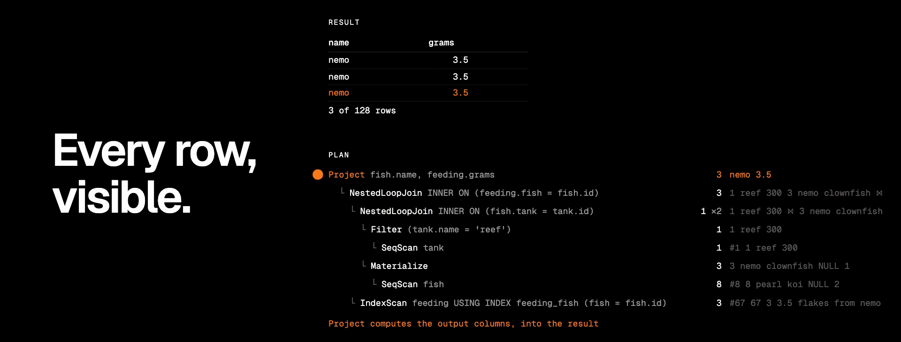

<p align="center">
  <picture>
    <source media="(prefers-color-scheme: dark)" srcset="brand/lockup.svg">
    
  </picture>
</p>

<p align="center">
  <a href="https://toxfied.github.io/Fishbowl/docs/"><strong>Documentation</strong></a>
  · <a href="https://toxfied.github.io/Fishbowl/">Live demo</a>
  · <a href="https://toxfied.github.io/Fishbowl/docs/case-study/">Case study</a>
  · <a href="#run-it">Quickstart</a>
  · <a href="sqllogictest/RESULTS.md">Test results</a>
</p>

<p align="center">
  <a href="https://github.com/ToxFied/Fishbowl/actions/workflows/ci.yml"></a>
  <code>Rust</code> <code>WebAssembly</code> <code>MIT</code>
</p>

**Fishbowl is a SQL database written from scratch in Rust. It passes 100% of
SQLite's 5.9 million sqllogictest records, and it runs in your browser, where
you can watch each query run row by row.**

<p align="center">
  <a href="https://toxfied.github.io/Fishbowl/media/fishbowl-demo.mp4">
    
  </a>
  <br>
  <a href="https://toxfied.github.io/Fishbowl/media/fishbowl-demo.mp4">Watch the 30-second demo</a>
</p>

Type a query and each row rises out of its table, through every step of the
plan, into the result. You can see why each step was chosen, which rows an
index let the query skip, and the B-tree pages the data lives on. The
[live demo](https://toxfied.github.io/Fishbowl/) is the real engine compiled to
WebAssembly, with no server.

## Correctness, measured

Fishbowl runs SQLite's own [sqllogictest](https://www.sqlite.org/sqllogictest)
suite, at check-in
[`ab599cbdd0976a63c5cfc7755588f716a7621f27`](https://www.sqlite.org/sqllogictest/info/ab599cbdd0976a63c5cfc7755588f716a7621f27)
(2026-10-07).

| Corpus | Files | Records run | Failed | Skipped | Pass rate | Queries only |
| --- | ---: | ---: | ---: | ---: | ---: | ---: |
| Full suite | 622 | 5,939,879 | 0 | 1,480,834 | **100.00%** | 100.00% |
| 29-file sample | 29 | 129,348 | 0 | 14,153 | **100.00%** | 100.00% |

The full suite is every test file in the repository at that check-in, and
gives the headline number. The sample is the fast check CI runs on every push.
Skipped records are ones a file marks as not applying to SQLite, such as
`onlyif mysql`; they are never counted as passes. Every file is pinned by
SHA-256, "not supported yet" counts as a failure, and the report is
byte-identical from run to run. Passing does not mean all of SQL works: the
suite never uses window functions, common table expressions or `ALTER TABLE`.
[`RESULTS.md`](sqllogictest/RESULTS.md) lists the last failures and how they
were fixed.

The suite is one of five checks. A differential test runs random scripts
through Fishbowl and the real `sqlite3` and requires the same answers.
Property tests compare the B-tree with Rust's `BTreeMap`. Bugs planted on
purpose check that the tests notice. A [crash test](docs/learn/crash-harness.md)
cuts the power at each of the 178 points where a workload writes to or syncs
the disk, and checks after 7,189 recoveries that every committed transaction
is there and nothing else is. [The case study](docs/case-study.md) covers all
five.

## What works

Queries can join tables, nest subqueries (correlated ones too), combine
results with `UNION`, `INTERSECT` and `EXCEPT`, and read views, along with
sorting, grouping and aggregates. `INSERT`, `UPDATE` and `DELETE` write to
B-trees on 4 KiB pages. `PRIMARY KEY`, `UNIQUE` and `CREATE INDEX` are
enforced on every write. A cost-based planner, using SQLite's cost model and
statistics from `ANALYZE`, chooses between a full scan and each index, orders
joins, looks up matching rows by index inside a join, and lets an index stand
in for a sort. It keeps the plans it turned down, with their costs, for the
UI. `BEGIN`, `COMMIT` and `ROLLBACK` group changes into transactions, which
commit through a write-ahead log. Triggers fire before, after or instead of
each changed row. Anything else is rejected with "not
supported yet" rather than answered wrongly.

| Part | State |
| --- | --- |
| Parse, plan, execute pipeline | Joins, subqueries, compound SELECTs, views, sorting, grouping, aggregates |
| Storage | Pager, buffer pool and B+tree tables on 4 KiB pages (M3) |
| Indexes and constraints | `PRIMARY KEY`, `UNIQUE`, `CREATE INDEX` (M4) |
| Cost-based planner | `ANALYZE`, SQLite's cost model, composite and covering indexes, index lookups in joins, join order search, rejected plans shown (M5) |
| Transactions and crash recovery | `BEGIN`/`COMMIT`/`ROLLBACK`, write-ahead log, checkpoints, recovery on open, crash test (M6) |
| Browser UI | Row-by-row trace playback, why this plan with the plans turned down, B-tree page viewer with live splits (M7, M5) |
| Proof | Full sqllogictest suite, CI workflow, case study (M8) |

## Run it

You need Rust (via [rustup](https://rustup.rs)) with the `wasm32-unknown-unknown`
target, `wasm-bindgen-cli` 0.2.129, Node.js, pnpm, and the `sqlite3` CLI for the
differential test. [Getting started](https://toxfied.github.io/Fishbowl/docs/getting-started/)
has more detail.

```bash
# Engine tests
cargo test --workspace

# SQL shell
cargo run -p fishbowl-cli -- -c "
  CREATE TABLE fish (id INTEGER PRIMARY KEY, name TEXT, species TEXT);
  INSERT INTO fish VALUES (1, 'goldie', 'goldfish'), (2, 'nemo', 'clownfish'),
                          (3, 'koko', 'koi'), (4, 'pearl', 'koi');
  CREATE INDEX fish_species ON fish (species);
  ANALYZE;
  SELECT name FROM fish WHERE species = 'koi';"
```

```text
name
-----
koko
pearl
(2 rows)

plan:
Project name  [rows=2]
  Filter (species = 'koi')  [rows=2]
    SeqScan fish  [rows=4]
      why: reading all 4 rows of fish is the cheapest way here
      estimate: rows=4 cost=12
      rejected: IndexScan fish USING INDEX fish_species (species = 'koi')  [rows=2 cost=13]
```

On four rows, reading them all is cheaper than finding two through the
index. On a big table the index wins.

```bash
# Browser UI at http://localhost:5173
cargo install wasm-bindgen-cli --version 0.2.129
pnpm --dir web install && pnpm --dir web dev

# Crash test: prints how many crash points it tried
cargo test -p fishbowl --test crash -- --nocapture

# sqllogictest, the 29-file sample: 26 MB, about 2 seconds
scripts/fetch-sqllogictest.sh
cargo run --release -p fishbowl-slt -- --write

# sqllogictest, the full suite: 1.2 GB, about 40 seconds on 10 cores
scripts/fetch-sqllogictest.sh --full
cargo run --release -p fishbowl-slt -- --full --write
```

`--write` updates the committed reports in `sqllogictest/`. The corpus
downloads into `sqllogictest/test`, a symlink to `test.nosync` so iCloud Drive
skips it.

## Layout

| Path | What |
| --- | --- |
| `crates/engine` | The engine: values, catalog, planner, executor, storage |
| `crates/cli` | `fishbowl` SQL shell |
| `crates/slt` | sqllogictest runner and report |
| `crates/wasm` | WebAssembly bindings |
| `web/` | React, Vite and Tailwind UI. A static site with no server |
| `website/` | The docs site, a Fumadocs app that renders `docs/` |
| `sqllogictest/` | Corpus manifests, [results](sqllogictest/RESULTS.md) and generated reports |
| `scripts/` | Fetch and pin the sqllogictest corpus |
| `docs/` | The docs: [case study](docs/case-study.md), [architecture](docs/architecture.md), [milestones](docs/milestones.md), [harness notes](docs/sqllogictest.md), [learning notes](docs/learn/index.md) |
| `brand/` | Logo, colors and type. See [BRAND.md](brand/BRAND.md) |

## License

MIT. The sqllogictest files are downloaded from sqlite.org and are not part of
this repository; see [their terms](docs/sqllogictest.md#license).
