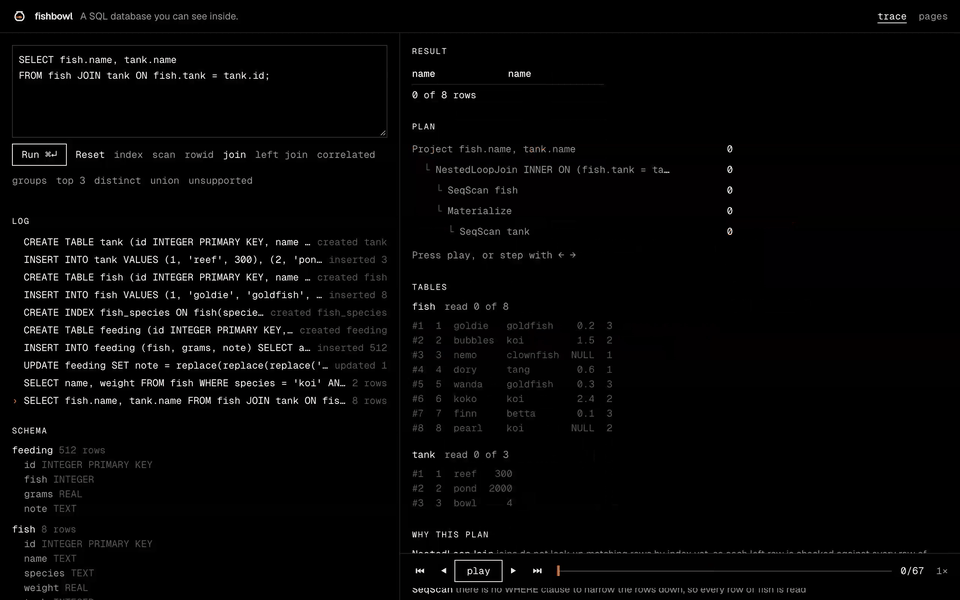

<p align="center">
  <picture>
    <source media="(prefers-color-scheme: dark)" srcset="brand/lockup.svg">
    
  </picture>
</p>

<p align="center"><strong>A SQL database you can see inside.</strong></p>

<p align="center">
  <a href="docs/CASE_STUDY.md">Case study</a>
  · <a href="sqllogictest/RESULTS.md">Test results</a>
  · <a href="docs/sqllogictest.md">How it's measured</a>
  · <a href="docs/PLAN.md">Plan</a>
  · <a href="docs/learn/README.md">Learn</a>
</p>

Fishbowl is a SQL database written from scratch in Rust. It compiles to
WebAssembly and runs in your browser, where you type a query and watch it run
row by row: each row rising out of its table, through every step of the plan,
into the result. You can see why each step was chosen, which rows an index let
the query skip, and the B-tree pages the data lives on.

<p align="center">
  
</p>

## Correctness, measured

Fishbowl runs SQLite's own [sqllogictest](https://www.sqlite.org/sqllogictest)
suite, at check-in
[`ab599cbdd0976a63c5cfc7755588f716a7621f27`](https://www.sqlite.org/sqllogictest/info/ab599cbdd0976a63c5cfc7755588f716a7621f27)
(2026-10-07).

| Corpus | Files | Records run | Failed | Skipped | Pass rate | Queries only |
| --- | ---: | ---: | ---: | ---: | ---: | ---: |
| Full suite | 622 | 5,939,879 | 458 | 1,480,834 | **99.99%** | 99.99% |
| 29-file sample | 29 | 129,348 | 131 | 14,153 | **99.89%** | 99.91% |

The full suite is every test file in the repository at that check-in, and
gives the headline number. The sample is the fast check CI runs on every push.
Skipped records are ones a file marks as not applying to SQLite, such as
`onlyif mysql`; they are never counted as passes. Every file is pinned by
SHA-256, "not supported yet" counts as a failure, and the report is
byte-identical from run to run. [`RESULTS.md`](sqllogictest/RESULTS.md) lists
what fails and why.

The suite is one of five checks. A differential test runs random scripts
through Fishbowl and the real `sqlite3` and requires the same answers.
Property tests compare the B-tree with Rust's `BTreeMap`. Bugs planted on
purpose check that the tests notice. A [crash test](docs/learn/crash-harness.md)
cuts the power at each of the 178 points where a workload writes to or syncs
the disk, and checks after 7,189 recoveries that every committed transaction
is there and nothing else is. [The case study](docs/CASE_STUDY.md) covers all
five.

## What works

Queries can join tables, nest subqueries (correlated ones too), combine
results with `UNION`, `INTERSECT` and `EXCEPT`, and read views, along with
sorting, grouping and aggregates. `INSERT`, `UPDATE` and `DELETE` write to
B-trees on 4 KiB pages. `PRIMARY KEY`, `UNIQUE` and `CREATE INDEX` are
enforced on every write, and a condition on an indexed column reads the index
instead of the whole table. `BEGIN`, `COMMIT` and `ROLLBACK` group changes
into transactions, which commit through a write-ahead log. Anything else is
rejected with "not supported yet" rather than answered wrongly.

| Part | State |
| --- | --- |
| Parse, plan, execute pipeline | Joins, subqueries, compound SELECTs, views, sorting, grouping, aggregates |
| Storage | Pager, buffer pool and B+tree tables on 4 KiB pages (M3) |
| Indexes and constraints | `PRIMARY KEY`, `UNIQUE`, `CREATE INDEX`, IndexScan chosen by a simple rule (M4) |
| Cost-based planner | In progress (M5) |
| Transactions and crash recovery | `BEGIN`/`COMMIT`/`ROLLBACK`, write-ahead log, checkpoints, recovery on open, crash test (M6) |
| Browser UI | Row-by-row trace playback, why this plan, B-tree page viewer with live splits (M7) |
| Proof | Full sqllogictest suite, CI workflow, case study (M8) |

## Run it

You need Rust (via [rustup](https://rustup.rs)) with the `wasm32-unknown-unknown`
target, `wasm-bindgen-cli` 0.2.129, Node.js and pnpm.

```bash
# Engine tests
cargo test --workspace

# SQL shell
cargo run -p fishbowl-cli -- -c "
  CREATE TABLE fish (id INTEGER, name TEXT);
  INSERT INTO fish VALUES (1, 'goldie'), (2, 'nemo');
  SELECT name FROM fish WHERE id > 1;"
```

```text
name
----
nemo
(1 row)

plan:
Project name  [rows=1]
  Filter (id > 1)  [rows=1]
    SeqScan fish  [rows=2]
      why: fish has no index, so every row is read
```

```bash
# Browser UI at http://localhost:5173
cargo install wasm-bindgen-cli --version 0.2.129
pnpm --dir web install && pnpm --dir web dev

# Crash test: prints how many crash points it tried
cargo test -p fishbowl --test crash -- --nocapture

# sqllogictest, the 29-file sample: 26 MB, about 8 seconds
scripts/fetch-sqllogictest.sh
cargo run --release -p fishbowl-slt -- --write

# sqllogictest, the full suite: 1.2 GB, about 35 seconds on 10 cores
scripts/fetch-sqllogictest.sh --full
cargo run --release -p fishbowl-slt -- --full --write
```

`--write` updates the committed reports in `sqllogictest/`. The corpus
downloads into `sqllogictest/test`, a symlink to `test.nosync` so iCloud Drive
skips it.

## Deploy the site

`pnpm --dir web build` writes a static site to `web/dist` with relative paths,
so it works from any URL prefix. To publish it on Cloudflare Pages:

```bash
npx -y wrangler@latest pages deploy web/dist --project-name fishbowl
```

It is not deployed yet.

## Layout

| Path | What |
| --- | --- |
| `crates/engine` | The engine: values, catalog, planner, executor, storage |
| `crates/cli` | `fishbowl` SQL shell |
| `crates/slt` | sqllogictest runner and report |
| `crates/wasm` | WebAssembly bindings |
| `web/` | React, Vite and Tailwind UI. A static site with no server |
| `guide/` | Private course on how Fishbowl works, a Lakebed app. See [its README](guide/README.md) |
| `sqllogictest/` | Corpus manifests, [results](sqllogictest/RESULTS.md) and generated reports |
| `scripts/` | Fetch and pin the sqllogictest corpus |
| `docs/` | [Case study](docs/CASE_STUDY.md), [plan](docs/PLAN.md), [harness notes](docs/sqllogictest.md), [learning notes](docs/learn/README.md) |
| `brand/` | Logo, colors and type. See [BRAND.md](brand/BRAND.md) |

## License

MIT. The sqllogictest files are downloaded from sqlite.org and are not part of
this repository; see [their terms](docs/sqllogictest.md#license).
