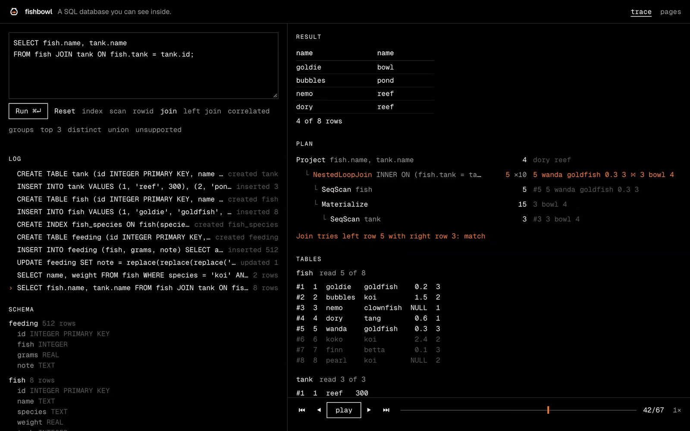

# Fishbowl: engineering case study

Fishbowl is a SQL database written from scratch in Rust. It runs natively and,
compiled to WebAssembly, in a browser page that shows each query running row by
row. Its correctness claim is a number: the share of SQLite's own sqllogictest
suite it passes. This page covers how that number is produced, what else backs
it, what was hard, and where the engine stops.

## The goal

Build a database small enough to understand and complete enough to be
measured against a real one. That meant three choices up front:

- **Target SQLite's behavior.** The sqllogictest expected answers are
  SQLite's, so matching SQLite is what the pass rate measures. That includes
  its odd parts: type affinity, NULL in `UNIQUE`, left-to-right compound
  queries.
- **Write the hard parts, borrow the solved one.** Parsing comes from the
  `sqlparser` crate. Planning, execution, the B-trees, the pager, the
  write-ahead log and recovery are Fishbowl's own.
- **Refuse rather than guess.** SQL the engine does not support fails with
  "not supported yet". A database that silently ignored an `ORDER BY` would
  return wrong answers; an error only costs pass rate.

## Architecture

```text
SQL text
  -> parse      sqlparser (SQLite dialect)
  -> plan       planner.rs: resolve names, choose access paths and join order
  -> execute    exec.rs: iterator model, one row at a time, rows counted per step
  -> store      storage/: pager and buffer pool, B+trees on 4 KiB pages,
                write-ahead log, recovery
```

| Part | Size | Notes |
| --- | ---: | --- |
| Engine (`crates/engine/src`) | 11,500 lines of Rust | No `unsafe` (`unsafe_code = "forbid"`) |
| Engine tests (`crates/engine/tests`) | 3,100 lines | 137 `#[test]` functions across the workspace, plus property tests |
| sqllogictest harness (`crates/slt`) | 1,200 lines | Own evaluator on the `sqllogictest` crate's parser |
| Browser UI (`web/`) | 1,600 lines of TypeScript | React, Vite, Tailwind; a static site with no server |

Decisions that shaped the rest:

| Decision | Why |
| --- | --- |
| Iterator ("Volcano") execution | Each plan step pulls one row at a time from the step below. That maps directly onto the tree the UI draws, and each step can count its rows. |
| Tables are B+trees keyed by rowid, indexes are separate B-trees keyed by (values, rowid) | SQLite's layout. One generic B-tree serves both, so its splits, merges and property tests cover both. |
| Write-ahead log with no steal | Uncommitted pages never leave memory, so recovery only replays committed frames. The cost: one transaction must fit in RAM. |
| Storage behind a page-store trait | A real file natively, memory in the browser, and a simulated disk that loses power on purpose in the crash test. |
| Row-level trace is an `Option` on the executor | An untraced query pays one check per row. A full corpus run with tracing forced on produced a byte-identical report. |



## How correctness is proven

Five independent checks, each aimed at a different way to be wrong.

### 1. SQLite's sqllogictest suite

| Corpus | Files | Records run | Failed | Skipped | Pass rate |
| --- | ---: | ---: | ---: | ---: | ---: |
| Full suite | 622 | 5,939,879 | 0 | 1,480,834 | 100.00% |
| 29-file sample | 29 | 129,348 | 0 | 14,153 | 100.00% |

Both are SQLite's sqllogictest at check-in `ab599cbdd0` (2026-10-07). The
full suite is every test file in the repository at that check-in. Skipped
records are ones the file marks as not applying to SQLite (`onlyif mysql` and
the like); they count neither as run nor as passed. Every one of the
5,939,879 records run passes.

A pass rate is only worth quoting if it is hard to inflate. The rules:

- **Pinned inputs.** Fossil names a check-in by the SHA-1 of its manifest,
  which lists every file's SHA-1. `scripts/pin-sqllogictest.sh` checks that
  chain, then writes a SHA-256 manifest. The runner refuses to report if any
  file is missing or changed.
- **"Not supported yet" fails,** even where the test expects an error. Only a
  parse error, an unknown name or a broken constraint satisfies
  `statement error`.
- **A panic fails one record,** and a runaway query fails at a 20 million row
  budget. A budget fails the same way on every machine; a timeout would not.
- **The report is deterministic.** No timings, no machine details. Two full
  runs produce identical bytes, so a diff in the committed report always means
  a change in behavior. CI fails if the committed sample report does not
  match a fresh run.
- **The harness is tested against itself:** wrong values, wrong hashes, wrong
  column counts and unsorted rows must all fail.
- **The README cannot drift.** A test checks that the numbers quoted in the
  README and the results page match the generated reports.

The suite has a limit worth stating. Almost all of it is generated: 65% of
the records are random queries over small tables and 35% are generated index
tests. It never uses window functions, common table expressions,
`ALTER TABLE` or JSON. 100% means Fishbowl matches SQLite on the SQL this
suite uses, not on all of SQL.

### 2. Differential tests against `sqlite3`

`crates/engine/tests/sqlite_differential.rs` generates random scripts (writes,
indexed queries, joins, subqueries, compound queries, transactions, failing
statements) and runs each through Fishbowl and the real `sqlite3` CLI, 3.54.0.
The two must agree on which statements fail and on every query's rows. It
runs 256 cases per `cargo test`. This test found most of the quirks below.

### 3. Property tests

- The B+tree must behave like Rust's `BTreeMap` through up to 1,000 random
  inserts, replaces, deletes, commits and rollbacks, 256 cases with a
  three-page buffer pool (constant eviction) and 256 with the normal pool.
  After each case it checks key order, equal leaf depth, the leaf chain, that
  every page is used exactly once, and that a fresh pager reopening the files
  sees the same contents.
- Random `INSERT`, `UPDATE` and `DELETE` through SQL must match a plain list.
- After every random write, each index must hold exactly one entry per row
  (`integrity_check`), and queries must return the same rows with and without
  indexes.

### 4. Mutation checks

A test that has never failed proves little, so bugs were planted on purpose:

- Three broken B-trees (a merge that forgets to relink leaves, a wrong
  separator after borrowing, a pager that drops dirty pages). Each failed 4
  of the 5 B-tree tests.
- Eight bugs in the write-ahead log code. The crash test caught seven. The
  eighth, checksumming each frame alone instead of as a chain, cannot be seen
  under the disk model, because the log is never overwritten; SQLite keeps
  the chain as a second defense, and so does Fishbowl.

### 5. The crash test

A 30-statement workload runs on a simulated disk that records every write,
sync and truncate. The test cuts the power at each of those 178 points, then
rebuilds the disk several ways: unsynced writes lost, kept, torn at every
512-byte sector boundary, or randomly mixed. Each of 7,189 recoveries must
keep every transaction whose `COMMIT` returned, show no other change, and pass
`integrity_check`. 3,370 of them crash a second time during recovery.

## Hard bugs and SQLite quirks

**The harness misreported before the engine did.** Three harness bugs would
have skewed the number, in both directions:

- `select1.test` and `select4.test` have no `hash-threshold` line but write
  large results as "N values hashing to ...". The harness compared rows to
  that line and failed correct answers. SQLite's runner compares by hash
  whenever the expected line is a hash.
- An `onlyif mssql` before a `halt` was dropped by the parser crate, so the
  `halt` stopped the file for every engine and the condition leaked onto the
  next record. The harness now tracks conditions itself.
- A `statement ok` record can hold two statements, which SQLite's runner
  passes to `sqlite3_exec` and runs both. The harness ran neither. The full
  suite surfaced this one.

**SQLite behavior the differential test found:**

- `SELECT 1 UNION SELECT 1.0` returns `1.0`: equal rows compare as one, and
  the right side replaces the left. `INTERSECT` and `EXCEPT` keep the left's.
- Compound operators run left to right with equal precedence, unlike standard
  SQL, so the planner flattens `sqlparser`'s tree back into a list.
- `UPDATE t SET a = a + 1` on a `UNIQUE` column holding 1, 2 and 3 fails,
  because constraints are checked row by row. The visiting order decides the
  outcome, so Fishbowl copies SQLite's: index order, unless the update changes
  that index, then rowid order.
- `INSERT OR FAIL` keeps the rows before a constraint failure, but a datatype
  mismatch still undoes everything.
- Inside a transaction, SQLite keeps the partial work of a failed `INSERT OR
  REPLACE`, `OR IGNORE`, `OR FAIL` or `OR ROLLBACK`. Fishbowl undoes it. This
  is the one documented difference.
- Affinity: `id = '5'` is true for an `INTEGER` column, `+id = '5'` is false,
  and `CAST('1e3' AS INTEGER)` is 1.

**The last failures in the full suite turned up more:**

- `max(DISTINCT a)` is not the same as `max(a)` when plain columns sit next
  to it. SQLite skips a repeated value without updating the row the plain
  columns come from, so with `a` = 1, 3, 3 the two pick different rows.
- `NOT INDEXED` cannot be ignored as a hint. It makes SQLite read in rowid
  order, which changes what `group_concat` returns.
- In triggers, `NEW.x` has no column affinity, despite the documentation, and
  SQLite visits the rows of an `UPDATE` with triggers in rowid order.

**The crash test was blind twice.** Torn writes always left the log short,
so recovery never read a torn frame; real file systems can grow a file before
writing its data, so the disk model now does too. And a frame torn inside the
zeros at the end of a page equals the whole frame, so the workload now fills a
leaf about 90% with text.

**Elsewhere:** `select5.test` joins up to 64 tables and ran out of row budget
on every query until joins started from a filtered table and followed the join
conditions; it now runs in half a second. In the browser, two overlapping
WebAssembly `init()` calls created two module instances and corrupted the
engine; it now initializes once.

## Performance

All on a 10-core Apple M4.

| Measure | Result |
| --- | --- |
| Full sqllogictest suite, 5.9 million records | about 40 s, 566 MB peak memory |
| 29-file sample | 1.8 s (7.8 s before the cost-based planner) |
| Join of 100,000 orders with 10,000 customers, no `ANALYZE` | 0.68 s (52.9 s before the cost-based planner) |
| Correlated subquery over the same tables | 0.07 s (67 s before) |
| Insert 100,000 rows into an indexed table in a file | 1.09 s (`sqlite3`: 0.04 s) |
| `count(*)` over those 100,000 rows, process start included | about 10 ms |
| Crash test, debug build | about 16 s |
| Browser download, gzipped | about 1 MB (921 KB of it the engine) |

The runner gives each file its own database and runs files on every core.
Starting the largest files first cut the full run from 44.6 s to 33 s in
back-to-back runs, because no long file is left running alone at the end.

The cost-based planner (M5) made the sample four times faster;
`select4.test` alone went from 9.7 s to 1.3 s. It costs time elsewhere. `select5.test`, with joins of up to 64 tables, went
from 0.22 s to 0.75 s, because the planner now searches join orders. The
full suite went from about 35 s to about 40 s across M5 and the fixes that
took it to 100%.

Fishbowl is about 27 times slower than SQLite at bulk inserts. The storage
layer has not been tuned for speed yet. The suite stays fast because its
tables are small, not because the engine is.

## Known limits

- **The planner is simpler than SQLite's.** It copies SQLite's cost model
  but not its `OR` optimization, skip-scan or automatic indexes.
- **Unsupported SQL:** common table expressions, window functions,
  `ALTER TABLE`, RIGHT and FULL joins, `USING`, `NATURAL`, savepoints,
  `AUTOINCREMENT`, `WITHOUT ROWID`, partial and expression indexes. Triggers
  work, but a trigger is replanned for every row it fires on, and a few
  forms (RAISE outside a SELECT, writing to a view from a trigger body) are
  rejected.
- **One connection per database file,** with no file locking. One
  transaction's changed pages must fit in memory. The log is not checkpointed
  on close.
- **The crash test trusts the operating system.** It checks Fishbowl against a
  model of a disk, not the real file code against real power loss, and does
  not cover disks that lose synced data or flip bits.
- **Speed,** as above.

## How it was built

The milestones ran in parallel lanes (SQL, storage, UI, proof), each on its
own branch and merged when its tests passed. The pass rate after each
merge, on the 29-file sample until M8:

| Milestone | Pass rate |
| --- | ---: |
| M0: engine slice and harness | 11.90% |
| M1: sorting, grouping, aggregates, scalar functions | 31.04% |
| M3: pager and B+tree storage | 31.06% |
| M4: indexes, `PRIMARY KEY`, `UNIQUE` | 84.31% |
| M2: joins, subqueries, compound queries, views | 99.89% |
| M6: transactions and crash recovery | 99.89% |
| M7: trace and page viewer | 99.89% |
| M5: cost-based planner, bit operators | 99.89% |
| M8: the full suite | 99.99% on 622 files |
| Last 452 failures: parser gaps, blobs, triggers | 100.00% on 622 files |

More detail: [the plan](PLAN.md), [the harness notes](sqllogictest.md) and
[the learning notes](learn/README.md), which explain each idea in plain
language.
